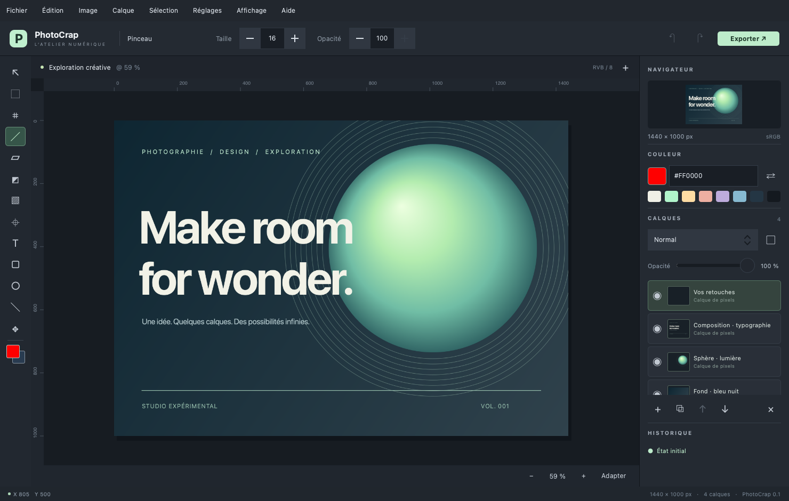

# PhotoCrap

[Français](README.md) | **English**

Desktop image editor written in **C++20, Qt 6, and QML**, designed for macOS, Linux, and Windows. Its interface, pixel engine, and project format are developed independently.

Current version: **v0.13.0**. Remaining work is tracked in [ROADMAP.md](ROADMAP.md).

## Download

[Release v0.13.0](https://github.com/fguilleme/PhotoCrap/releases/tag/v0.13.0) provides a **macOS arm64 DMG**, a **Linux x86_64 AppImage**, a **Windows x64 installer**, and a **portable Windows ZIP**, with `.sha256` files. Publication runs automatically after builds, tests, and deployment checks succeed on all three platforms; see [GitHub Actions](https://github.com/fguilleme/PhotoCrap/actions/workflows/build.yml) for its status. Qt is bundled; a Qt installation is needed only to build the project.

The internal version and package filenames now use **0.13.0**. Older v0.12.0 packages still used the 0.11.0 version number.

## New in v0.13.0

This release retains the v0.12.0 features (RAW, 16-bit pixels, crop and slice tools, editable frequency separation, and up to 512 layers) and adds:

- **Pen (P)**: editable Bézier paths and handles, corner/smooth points, add/delete/convert point tools, fill, stroke, and v8 project persistence. Converting to a selection hides the path overlay; choose the saved path in the options bar to edit it again. Command/Ctrl moves anchors, with an accurately aligned cursor tip. [Interactions and limitations](docs/TOOL_INTERACTIONS.md#plume-et-tracés-bézier).
- **Magic Eraser**: color-based erasing, cancellable asynchronous processing, and native 8/16-bit precision.
- **Separate layer and mask context menus**: properties, locking, mask inversion and deletion, with missing features disabled and marked **NYI**.
- **Application shutdown** fixed with floating or hidden panels, while preserving the unsaved-document confirmation.



## Features

- 8- or 16-bit-per-channel sRGB RGB documents with a white or transparent background, custom dimensions, and presets.
- Image import, project opening, centered import as a layer, and clipboard paste.
- Round stamp brush and eraser with size, hardness, opacity, cumulative flow, spacing, angle, roundness, and smoothing. A tip outline follows the pointer, and a stroke preview is available under **View → Brush…**. Photoshop-style shortcuts control size (`[`/`]`), hardness (`Shift+[`/`Shift+]`), and foreground/background colors (`D`/`X`).
- Grouped toolbar: right-click to choose a tool, the last chosen tool supplies the icon, and tooltips identify tools. Group order, tool order, and visibility are configurable under **Settings → Toolbar**. Unimplemented tools remain visible, disabled, and marked **NYI**.
- Magic Eraser in the **E** group: right-click to choose it, then click a color to erase matching pixels on the active layer. The options bar provides tolerance, anti-aliasing, contiguous pixels, sampling all visible layers, and opacity. Background processing, **Escape** to cancel, selection clipping, and native 8/16-bit precision. This tool erases pixels, not layer masks.
- Painting and retouching: brush, pencil, color replacement, mixer brush, eraser, clone stamp, pattern stamp, blur, sharpen, smudge, dodge/burn, sponge, red eye correction, healing brush, spot healing, patch, content-aware move, remove, and history brushes.
- Eyedropper with point/average sampling, four color samplers, ruler, contiguous fill, and two-color gradient. Raster shapes include rectangle, ellipse, triangle, polygon, star, and line with fill/stroke controls. Horizontal text is rasterized.
- Photoshop-style navigation: `Ctrl/⌘ + wheel` zooms around the pointer, the wheel scrolls vertically, `Shift + wheel` scrolls horizontally, and `Space + drag` freely pans the canvas.
- Rectangular, elliptical, single-row/column, lasso, polygonal lasso, quick selection, and magic wand tools. Animated selection contours, replace/add/subtract/intersect modes, selected-pixel movement, deletion, merged copy, and cropping.
- Pixel layers, Solid Color fills, adjustments, groups, and clipping: add, duplicate, rename, reorder, show/hide, lock, opacity, and merge down. White/black raster masks can be painted, inverted, enabled/disabled, and copied to another layer by dragging. Alt/Option-click an eye to isolate a layer or a mask thumbnail to display the mask alone.
- Separate context menus for layers and mask thumbnails: properties, locking, duplication, grouping, and merge down for layers; viewing, enabling, inversion, and deletion for masks. Unavailable commands are disabled; missing features are marked **NYI**.
- All 27 RGB blend modes arranged by family with hover previews: clicking commits the mode, while leaving the menu restores the previous state.
- Nondestructive adjustment layers: **Light** (exposure, contrast, highlights, shadows, whites, blacks), **Color** (temperature, tint, vibrance, saturation, and white-balance eyedropper), Levels, Curves, Color Balance, Black & White, Photo Filter, Channel Mixer, Color Style (LUT), Invert, Posterize, Threshold, Gradient Map, and Selective Color. Gaussian blur, motion blur, box blur, unsharp mask, high pass, mosaic, and noise are also available as filter layers. Older project parameters remain readable; each adjustment receives a white or selection-derived mask.
- Specialized editors: Curves with histogram, control points, and four eyedroppers; Levels with input/output handles; Black & White with six color families, presets, Auto, and Tint; Gradient Map with a two-pointer color wheel; Photo Filter and Channel Mixer with presets. A common action bar provides clipping, visibility, reset, and deletion.
- Dynamic frequency separation with a blurred low-frequency layer and a linked high-frequency layer in Linear Light mode. Their shared radius is recomputed while the slider moves; downscaled preview and caching avoid unnecessary blur recomputation. **Prepare retouching** then computes both bands in the background and converts them to editable pixels, leaving the original untouched: brush/blur on Low frequencies, Clone Stamp sampling the current layer on High frequencies. Masks, opacity, blend modes and 8/16-bit depth are preserved. Sources are retained within the document budget. **Return to radius settings** restores the dynamic pair after confirmation that its retouches will be discarded; this operation can itself be undone. The **ƒ** button remains available on both layers to reopen the panel and retouching guidance, including after reopening the project.
- Direct active-layer adjustments: brightness, contrast, saturation, black and white, invert, sepia, blur, and sharpen. Selections restrict their application area.
- Adjustment previews run in the background on downscaled proxies. Intermediate requests are replaced by the latest value; a full-resolution asynchronous render updates the display cache. Cancel restores a properties session; Close keeps its changes. In a numeric field, the first Return commits and leaves editing; the next activates the default button.
- Resize, 90° rotation, flips, zoom, view rotation, canvas panning, rulers, and navigator preview.
- **Histogram, Navigator, Color, Layers, Channels, History, and Info** panels support rearrangement, tab groups, columns, collapse, resizing, floating windows, and persistent workspace layout. **View → Panels** controls visibility. Channels displays RGB or an individual grayscale channel without changing the document.
- Undo/redo history with saved-state tracking. Unsaved-change protection when opening, creating, or closing a document.
- A **Settings** window with **Keyboard Shortcuts**, **Interface**, and **Toolbar** sections. Shortcuts are editable, validated, and persistent; French or English can be applied at runtime and the language choice is retained.
- Atomic `.pcr` project saving with layers. Flattened PNG, JPEG, BMP, and WebP export when the corresponding module is installed. JPEG and BMP composite transparency over white.
- An editable demo composition from **File → Open Demo Composition**, or with the `--demo` option.
- A persistent list of the ten most recently opened or saved files under **File → Open Recent Files**. Missing files are removed automatically.

## Building

Requirements: CMake ≥ 3.24, a C++20 compiler, and **Qt ≥ 6.5** with Core, Gui, Concurrent, Qml, Quick, QuickControls2, LinguistTools, and Test (for tests). The QtQuick.Dialogs and QtQml.Models QML modules are also required. Qt Image Formats adds formats including WebP and TIFF. Blur uses Accelerate/vImage on macOS and Qt Concurrent on other platforms; each binary must be built with the Qt kit for its target platform.

### macOS

With Xcode Command Line Tools and Qt installed through Homebrew:

```sh
brew install qt cmake
cmake -S . -B build -DCMAKE_BUILD_TYPE=Release -DCMAKE_PREFIX_PATH="$(brew --prefix qt)"
cmake --build build --parallel
ctest --test-dir build --output-on-failure
open build/PhotoCrap.app
```

To open the demo:

```sh
open build/PhotoCrap.app --args --demo
```

The development bundle uses the installed Qt libraries. To collect its libraries and QML modules into a distributable bundle:

```sh
cmake --install build --prefix dist
open dist/PhotoCrap.app
```

Developer ID signing and notarization are not configured.

### Linux

Install a **Qt 6.8.3 Desktop gcc_64** kit with the Qt installer, including Qt Declarative, Qt Quick Controls, and Qt Image Formats. On Ubuntu, install the build tools and system dependencies:

```sh
sudo apt install build-essential cmake libgl1-mesa-dev libxkbcommon-dev libxcb-cursor0
cmake -S . -B build -DCMAKE_BUILD_TYPE=Release -DCMAKE_PREFIX_PATH="$HOME/Qt/6.8.3/gcc_64"
cmake --build build --parallel
ctest --test-dir build --output-on-failure
./build/PhotoCrap
```

Adjust `CMAKE_PREFIX_PATH` to the actual kit path. Distribution packages can also be used when they provide Qt ≥ 6.5 and the matching QML imports. Note that [Ubuntu 24.04 provides Qt 6.4.2](https://packages.ubuntu.com/noble/qt6-base-dev), which is too old for this project; use the Qt kit listed above on that distribution.

An installation through `cmake --install build --prefix dist` uses Qt’s CMake deployment support. The GitHub workflow places that tree in an **x86_64 AppImage** whose launcher configures the bundled libraries, plugins, and QML imports. After `chmod +x`, the AppImage runs without a local Qt installation.

### Windows

Install Visual Studio 2022 with the C++ workload, CMake, and a **Qt 6.8.3 MSVC 2022 64-bit** kit with Qt Declarative, Qt Quick Controls, and Qt Image Formats. In PowerShell:

```powershell
cmake -S . -B build -G "Visual Studio 17 2022" -A x64 -DCMAKE_PREFIX_PATH="C:/Qt/6.8.3/msvc2022_64"
cmake --build build --config Release --parallel
ctest --test-dir build -C Release --output-on-failure
cmake --install build --config Release --prefix dist
.\dist\bin\PhotoCrap.exe
```

The installation step bundles the Qt libraries, plugins, and QML imports. The workflow publishes two standalone variants: an NSIS `.exe` installer with shortcuts and uninstall support, and a portable ZIP to extract and run. A MinGW kit must be paired with its corresponding MinGW compiler rather than the Visual Studio generator.

Each successful GitHub run publishes a standalone macOS DMG, a Linux AppImage, and both the Windows installer and portable ZIP. CI refuses to publish them when Qt Core, the platform plugin, or the Qt Quick QML modules are missing. Developer ID signing, macOS notarization, and Windows Authenticode signing require certificates and are not configured yet.

### Qt Creator and presets

Open `CMakeLists.txt` in Qt Creator, select the machine’s Qt kit, and run the `PhotoCrap` target. If Qt is already in `CMAKE_PREFIX_PATH`, the presets can also be used:

```sh
cmake --preset release
cmake --build --preset release
ctest --preset release
```

## Usage

1. Create a document, open an image, or load the demo.
2. Select a layer in the list on the right. On the development branch, right-click the layer for its commands, or right-click its **mask thumbnail** for mask commands without opening the properties dialog. The **◐** button adds or selects its mask. The **ƒ** button opens adjustment, active mask, or frequency-separation settings. Double-click opens properties when available, otherwise renaming.
3. Select a tool on the left and draw on the canvas. Text options appear in the bar below the canvas; each click rasterizes the text into the active layer.
4. To crop, draw a region and click **Crop**. Adjustments and brush strokes honor the selection; deselect it to affect the whole image.
5. Save as `.pcr` to preserve layers, then export a flattened image for sharing.

### Tools and shortcuts

Each toolbar button represents a group. **Right-click** reveals its variants; the icon and shortcut recall the last chosen tool. Currently wired default keys are:

| Key | Group / available tools |
|---|---|
| V | Move |
| M | Rectangular, elliptical, single-row, single-column marquee |
| L | Lasso, polygonal lasso |
| W | Quick selection, magic wand |
| C | Crop, perspective, slices |
| I | Eyedropper, color sampler, ruler |
| J | Spot healing, remove, healing, patch, content-aware move, red eye |
| B | Brush, pencil, color replacement, mixer brush |
| S | Clone stamp, pattern stamp |
| Y | History brush, Art History Brush (development branch) |
| E | Eraser |
| G | Gradient, contiguous fill |
| O | Dodge, burn, sponge |
| P | Pen, Add/Delete Anchor Point, Convert Point |
| T | Rasterized horizontal text |
| U | Rectangle, ellipse, triangle, polygon, star, line |
| H / R / Z | Hand / rotate view / zoom |

On the development branch, **Y** selects history brushes. **Shift + key** and **Option/Alt-click** cycle variants; holding a letter temporarily selects its tool. These behaviors are configurable in Settings. Blur, Sharpen, and Smudge share a group without a default letter. **NYI** entries remain disabled. The [mouse and keyboard guide](docs/TOOL_INTERACTIONS.md) (French) lists Adobe references and current limitations.

`[` / `]` change brush size; `Shift+[` / `Shift+]` change hardness; `D` restores black/white and `X` swaps colors. `Ctrl/⌘ + 0` fits the image; `Ctrl/⌘ + 1` displays 100%. `Ctrl/⌘ + wheel` zooms under the pointer, the wheel scrolls vertically, `Shift + wheel` horizontally, and `Space + drag` pans the canvas. Undo/Redo preserves the navigation zoom.

The catalog contains **282 entries**, with action/key/context search and **Available**, **NYI**, and **Contextual gestures** filters. Missing features remain disabled references and never capture keys. Mouse gestures are documented without registering global shortcuts. The [detailed inventory](docs/SHORTCUTS.md) (French) also tracks missing functionality.

Customize shortcuts and the toolbar in **Settings**: **PhotoCrap → Preferences…** or **⌘,** on macOS, **Edit → Settings…** on other platforms. Shortcuts are suspended during text entry or modal dialogs. Empty combinations disable commands, duplicates are rejected, and customizations persist between launches.

### Retouching and history brushes

**Patch** (`J`) copies a nearby texture into a selection and adapts its boundary color. Source and Destination modes and Diffusion (1–7) are supported; this implements Normal mode on the active pixel layer, without Photoshop’s Content-Aware, Transparent, or Pattern options.

**Content-Aware Move** (`J`) moves a selected object and reconstructs its old position; Extend also retains the original. Structure, Color, and Sample All Layers control the local texture/color reconstruction. **Remove** (`J`) marks regions with a brush or loop, supports subtraction and batch application, and computes a local reconstruction asynchronously. These are local texture algorithms, not generative AI; complex backgrounds can require additional retouching.

**History Brush** and **Art History Brush** (toolbar group labelled `Y`) use a retained source state chosen in History or the tool options. History Brush restores matching pixels on the same layer. Art History Brush paints stylized strokes from the source’s colors with ten styles, Area, and Tolerance controls. Source dimensions and layer identity must match; both currently paint pixel layers rather than masks. Select Current State and leave Tolerance at zero for a simple artistic-brush trial. Each gesture makes one undo step and processing is limited to affected regions.

### Eyedroppers and Info

Eyedropper and Color Sampler support point sampling and 3 × 3, 5 × 5, 11 × 11, 31 × 31, 51 × 51, and 101 × 101 averages. Sources currently include All Layers and Current Layer (or its selected mask). Click/drag selects the foreground color; Alt/Option selects the background, and Shift-click places a sampler. An optional sampling ring compares the new color with the pre-gesture color.

Up to four numbered samplers remain on the image; their RGB values appear in **Info**. Drag to move them, Alt/Option-click or drag outside the image to remove one, and use Clear All to remove all. A fifth click does not overwrite an existing sampler. Readouts follow image and sampling-setting changes without creating pixel history.

**Info** also displays pointer RGB values and coordinates, Ruler X/Y/width/height/angle/D1, and selection/document dimensions. It is initially hidden and opens automatically with measuring/sampling tools and adjustment eyedroppers. It floats by default; after docking or grouping, it reuses the saved workspace placement. **View → Panels → Info** toggles it; closing its floating window hides it without discarding its placement. Shift constrains the Ruler to 45° increments.

Tool cursors have precise native hotspots, including Curves and white-balance eyedroppers. Sampling uses the completed full-resolution composite, or the latest finished proxy while a render is pending, excluding selection overlays and channel visualization. The unresolved first-activation macOS cursor check is tracked in the [roadmap](ROADMAP.md).

Adobe references: [pixel values and color samplers](https://helpx.adobe.com/photoshop/desktop/adjust-color/selective-color-adjustments/view-pixel-color-values-in-an-image.html), [Ruler](https://helpx.adobe.com/photoshop/using/positioning-ruler-tool.html), [Info panel](https://helpx.adobe.com/photoshop/desktop/get-started/settings-and-preferences/use-the-info-panel-and-document-status-bar.html).

### Crop and slices (development branch)

The **C** group now contains Crop, Perspective Crop, Slice, and Slice Select, accessed by right-clicking its icon. These additions are newer than release 0.11.0.

- **Crop**: draw a frame, move it, or adjust its eight handles. Select an aspect ratio, swap its orientation, or enter output dimensions in pixels. A grid and shaded exterior help framing. Return applies; Escape discards.
- **Perspective Crop**: draw a frame and align its four corners with the subject’s edges. Return rectifies the quadrilateral and crops all layers, masks, and sources in the background. Undo restores the original image.
- **Slices**: draw rectangles with Slice. Slice Select moves, resizes, deletes, or divides them into rows/columns. User slices are saved in the project and exported as PNG without overwriting existing files. Auto slices are visual guides, not editable or exported regions.

Cropping removes pixels outside the frame; Undo recovers them. Nondestructive retention outside the canvas, rotation/line-based straightening, resolution presets, and HTML slice export remain unimplemented. A dimension change clears slice guides; Undo restores them.

## Architecture

| File | Responsibility |
|---|---|
| `src/Document.h`, `src/Document.cpp` | Document model, shared state, history, and histograms |
| `src/DocumentLayers.cpp`, `src/DocumentEditing.cpp`, `src/DocumentIO.cpp` | Layers/masks, editing/transforms, and project I/O |
| `src/DocumentCompositor.cpp`, `src/DocumentPreview.cpp` | Composition, proxy caches, full-resolution renders, and asynchronous scheduling |
| `src/DocumentAdjustments.cpp`, `src/DocumentFilters.cpp`, `src/filters/*` | Adjustment orchestration and specialized calculation modules |
| `src/tools/PenTool.cpp`, `src/tools/PenPath.*`, `qml/PenOptions.qml`, `qml/PenOverlay.qml` | Bézier geometry, editing, and display |
| `src/tools/*` | Gesture controller, settings, and tool implementations split by family |
| `src/CanvasItem.*` | Qt Quick rendering, checkerboard, selection contours, and native cursors |
| `src/main.cpp`, `src/ShortcutManager.*`, `src/LanguageManager.*`, `src/RecentFilesManager.*`, `src/WorkspaceSettings.*` | Startup, QML exposure, languages, recent files, shortcuts, and persistent workspace settings |
| `qml/Main.qml`, `qml/*Editor.qml`, `qml/*Options.qml` | Window, menus, dialogs, adjustment editors, and specialized tool option bars |
| `qml/DockablePanel.qml`, `qml/InformationPanel.qml` | Shared panel container and measurement display |
| `qml/LayerContextMenu.qml`, `qml/MaskContextMenu.qml`, `tests/LayerContextMenuSmoke.h` | Target-specific context menus and right-click/action tests |
| `tests/DocumentTest.cpp`, `tests/UiSmoke.h`, `tests/Mac*Test.*` | Engine, QML interaction, and native macOS menu/cursor tests |
| `.github/workflows/build.yml`, `cmake/*`, `packaging/*` | Builds, tests, deployment, packaging, signature checks, and release publication |

Layers are stored from bottom to top in `QImage::Format_ARGB32_Premultiplied` (8-bit channels) or `QImage::Format_RGBA64_Premultiplied` (16-bit channels). Masks remain 8-bit; screen proxies may use 8-bit pixels without changing the working images. The composite and frequency-separation renders are cached. During a stroke, only affected regions are recomposed, so frequency blur is not recalculated when a mask changes. History snapshots use QImage implicit sharing; one continuous gesture becomes one operation. History is limited to 40 operations and approximately 256 MiB of image data retained in addition to the current document, with at least one undo preserved even when it exceeds that budget.

The `.pcr` file is a versioned JSON document. Version 8 stores Bézier paths, channel depth, pixels, masks, frequency-separation pairs, adjustments, and layer properties, including groups and clipping, while remaining backward-compatible with versions 1–7. Empty pixel layers and uniform masks use compact storage in this version, expanding only when locally edited. History, selection, and color sampler markers are not saved in the project; panel organization is stored separately in application settings. Loading validates every layer before replacing the open document. Maximum file size is 256 MiB; a document is limited to 32 megapixels, 512 layers, and 2 GiB of uncompressed layer data. The budget separately counts color pixels, frequency-separation sources, and 8-bit masks; adjustments reserve only their masks, and groups reserve no image. Nonuniform shared images are reserved independently for each layer so they can be edited and reloaded. Empty layers and uniform masks do not reserve full-sized planes; painting checks the budget before expanding them. The frequency cache uses LRU eviction with a 128 MiB budget, and frequency thumbnails render at display size. These limits do not represent total memory consumption: composition, filters, history, and serialization also use memory.

### Magic Eraser (development branch)

Right-click the **E** group and choose **Magic Eraser**, then click the color to erase on an unlocked pixel layer. **Tolerance** controls the accepted color difference. **Contiguous** restricts erasing to the connected area around the click; disabling it matches colors throughout the selection or image. **Anti-alias** softens edges, and **Opacity** controls how much is erased.

**All layers** samples the visible composite but modifies only the active layer. Processing runs in the background and **Escape** cancels it. A selection restricts the affected area, and each applied click creates one undo step. Working pixels retain 8- or 16-bit precision. The tool operates on pixel layers and does not act on fully transparent samples; Background Eraser remains **NYI**.

### Layer and mask context menus (development branch)

The **layer** menu provides available properties, duplication, renaming, deletion, locking, clipping, grouping, merge down, and visibility. Single-layer actions are disabled when multiple layers are selected; grouping uses the multiple selection.

Right-clicking a **mask thumbnail** targets that mask: properties, isolated viewing, enable/disable, inversion, and deletion. Inversion and deletion are undoable; mutation commands in this menu are disabled on locked layers. Missing features remain visible with **NYI**, including applying/unlinking masks, loading a mask as a selection, selected/visible layer merging, flattening, smart objects, and advanced blending options.

## Validation and limitations

Tests cover painting/undo, opacity, visibility, locking, selection, cropping, movement, fill, filters, transforms, merging, save/reopen, export, failed saves, and rejection of corrupted files. A separate test starts the QML engine, draws through mouse events, verifies text entry and unsaved-change protection, and produces an offscreen render without QML errors. Interaction checks are compiled when `BUILD_TESTING=ON`.

```sh
QT_QPA_PLATFORM=offscreen QT_QUICK_BACKEND=software \
  ./build/PhotoCrap.app/Contents/MacOS/PhotoCrap --smoke-test --screenshot /tmp/photocrap.png
```

On Linux, use `./build/PhotoCrap`. Native macOS tests use Cocoa separately from the offscreen smoke test. See [Download](#download) for verified workflow status and the [roadmap](ROADMAP.md) for remaining validation and features.

Known limitations: one document at a time; CPU raster composition with native accelerated blur on macOS; some editing paths remain synchronous and may slow down very large images; text cannot be edited after rasterization; no PSD/PSB, CMYK, HDR, 32-bit, vector masks, smart objects, generative repair, textured brush tips and advanced dynamics, stylus pressure/tilt, or AI. Adjustment algorithms are simplified sRGB implementations and do not exactly reproduce Photoshop’s color results. Fill compares colors exactly, without tolerance. Direct filters modify pixels; history can undo them. The navigator is a preview without an interactive navigation rectangle. sRGB is normalized on import without a display/print proofing pipeline.

## Technical references

- [Qt CMake/QML integration](https://doc.qt.io/qt-6/qtqml-cmake-integration.html)
- [Deploying QML applications](https://doc.qt.io/qt-6/qt-generate-deploy-qml-app-script.html)
- [QPainter composition](https://doc.qt.io/qt-6/qpainter.html)
- [Installing Qt in GitHub Actions](https://github.com/jurplel/install-qt-action)

## RAW and color precision

RAW files are developed asynchronously through LibRaw 0.22.2 using camera white balance, orientation and 16-bit sRGB output. Opening and layer import decode sensor data rather than embedded previews; loading can be cancelled. Camera compatibility depends on LibRaw and encoding. An original synthetic Bayer DNG is exercised by automated tests. Lossy JPEG and JPEG XL DNG are unsupported by this build.

Choose 8- or 16-bit channels on creation or under **Image → Color depth**. Photo adjustments, masks, blends, spatial filters, Brush, Eraser, Stamp, shapes and Crop retain 16-bit storage; projects and PNG export preserve it. JPEG, BMP and WebP output 8-bit pixels. Converting 8 to 16 bits does not recover lost precision.

Smudge, Mixer Brush, Healing, Spot Healing, Remove, Patch, Content-Aware Move, Red Eye, Color Replacement and both History Brushes currently require 8-bit pixels and are explicitly blocked on 16-bit pixel layers. Documents remain limited to 32 megapixels and 2 GiB of uncompressed layer data, with 8 bytes per 16-bit color pixel and 1 byte per mask pixel (rows aligned to 4 bytes).

CMake fetches pinned, SHA-256-verified LibRaw and zlib sources and links them statically. Standalone packages ship their unmodified sources and notices under `third-party`; LibRaw is distributed under CDDL 1.0.
