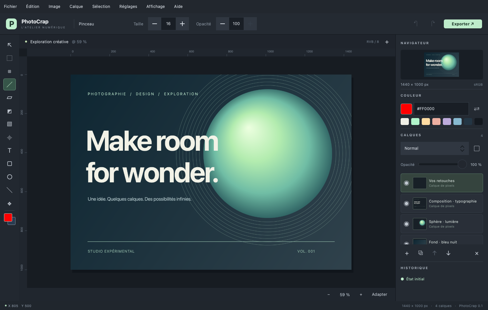

# PhotoCrap

**Français** | [English](README.en.md)

Éditeur d’images de bureau en **C++20, Qt 6 et QML**, conçu pour macOS, Linux et Windows. L’interface, le moteur de pixels et le format de projet sont développés indépendamment.

Version courante : **v0.15**. Les travaux restants sont suivis dans [ROADMAP.md](ROADMAP.md).

La **v0.16** est en préparation (version interne **0.16.0**) : aperçus GPU, guides
et graphiques retenus, texte éditable. Sa publication reste en attente de validation
des trois plateformes ; voir les [notes de version](CHANGELOG.md).

## Télécharger

La [release v0.15](https://github.com/fguilleme/PhotoCrap/releases/tag/v0.15) fournit un **DMG macOS arm64**, une **AppImage Linux x86_64**, un **installateur Windows x64** et un **ZIP Windows portable**, accompagnés de fichiers `.sha256`. La publication est automatique après réussite des builds, tests et contrôles de déploiement des trois plateformes ; consulter [GitHub Actions](https://github.com/fguilleme/PhotoCrap/actions/workflows/build.yml) pour son état. Les paquets embarquent Qt ; une installation de Qt est nécessaire seulement pour compiler le projet.

Le tag est **v0.15** ; la version interne et les noms des paquets utilisent **0.15.0**.

## Nouveautés de v0.15

- **Moins de copies mémoire** pendant la composition en mode Normal, la lecture des sources et le retour des rendus en arrière-plan. Les calques invisibles ne sont plus réduits pour les aperçus.
- **Cache de travail disque** pour les gros rendus de fréquences : réutilisation entre workers, blocs natifs 8/16 bits sans recompression, vérification SHA-256 et lecture par fichiers mappés. **Réglages → Cache de travail** permet de choisir le dossier, le budget (4 Gio par défaut, 0 pour désactiver) et de vider le cache.
- **Couverture du pinceau, du crayon et de la gomme par tuiles de 256 × 256** : seules les tuiles touchées sont allouées, sur les pixels et les masques. Un petit trait sur un masque de document 24 Mpx/16 bits utilise 512 Kio de couverture au lieu d’environ 183 Mio.
- **Cache LRU de fréquences corrigé** : une bande haute déjà présente est réutilisée sans recalculer sa bande basse évincée.
- **Tests de mémoire et de rendu renforcés** : 64 calques remplis en 8/16 bits, versions de tuiles partagées, éviction, nettoyage, stockage indisponible, concurrence et Annuler/Rétablir.

Le [guide calques et mémoire](docs/LAYER_MEMORY.md) décrit le fonctionnement et les mesures. Les plans éditables des calques et l’historique utilisent encore des images complètes en RAM ; leur migration par tuiles reste à faire. Les limites de 32 Mpx, 512 calques et 2 Gio de plans de calques restent en place. L’application écrit le format `.pcr` v9 avec texte éditable et lit aussi les projets v1 à v8. Les [fonctions de sélection de v0.14](CHANGELOG.md#v014--28-octobre-2026) restent disponibles.



## Fonctionnalités

- Documents RVB 8 ou 16 bits par canal sRGB, fond blanc ou transparent, dimensions personnalisées et préréglages.
- Import d’images, ouverture de projets, import centré comme calque et collage du presse-papiers.
- Pinceau rond et gomme à empreintes : taille, dureté, opacité, débit cumulatif, espacement, angle, arrondi et lissage. Le contour de pointe suit le pointeur et un aperçu de trait est affiché dans **Affichage → Pinceau…**. Les raccourcis suivent Photoshop pour la taille (`[`/`]`), la dureté (`Maj+[`/`Maj+]`) et les couleurs avant/arrière-plan (`D`/`X`).
- Barre d’outils organisée par groupes : clic droit pour choisir un outil, icône du dernier outil choisi et infobulles. Ordre des groupes, ordre des outils et visibilité personnalisables dans **Réglages → Barre d’outils** ; les outils non implémentés restent visibles, désactivés et marqués **NYI**.
- Gomme magique dans le groupe **E** : clic droit pour la choisir, puis clic sur une couleur pour l’effacer du calque actif. Tolérance, lissage, pixels contigus, échantillonnage de tous les calques et opacité dans la barre supérieure. Calcul en arrière-plan, **Échap** pour annuler, sélection respectée et précision 8/16 bits conservée. Elle agit sur les pixels, pas sur les masques.
- Peinture et retouche : pinceau, crayon, remplacement de couleur, pinceau mélangeur, gomme, tampon de duplication, tampon de motif, flou, netteté, doigt, densité −/+, éponge, correction des yeux rouges, correcteur, correcteur localisé, pièce, déplacement basé sur le contenu, suppression et formes d’historique.
- Pipette avec prélèvement ponctuel ou moyen, quatre échantillons de couleur, règle, remplissage contigu et dégradé à deux couleurs. Formes raster : rectangle, ellipse, triangle, polygone, étoile et ligne, avec paramètres de remplissage et de contour. Texte horizontal éditable en calque dédié, avec formats mixtes de caractères et de paragraphes.
- Navigation façon Photoshop : `Ctrl/⌘ + molette` zoome autour du pointeur, la molette défile verticalement, `Maj + molette` horizontalement et `Espace + glisser` déplace librement la toile.
- Sélections rectangulaire, elliptique, rangée/colonne unique, lasso, lasso polygonal, sélection rapide et baguette magique. Contours animés, modes remplacer/ajouter/soustraire/intersection, déplacement des pixels sélectionnés, effacement, copie fusionnée et recadrage.
- Calques de pixels, texte éditable, remplissage Couleur unie, réglages, groupes et écrêtage : ajout, duplication, renommage, ordre, visibilité, verrouillage, opacité et fusion vers le bas. Masques raster blancs/noirs, peinture, inversion, activation/désactivation et copie d’un masque vers un autre calque par glisser. Alt-clic sur l’œil isole un calque ; Alt-clic sur une vignette de masque affiche le masque seul.
- Menus contextuels distincts pour les calques et les vignettes de masque : propriétés, verrouillage, duplication, regroupement et fusion vers le bas côté calque ; affichage, activation, inversion et suppression côté masque. Les commandes indisponibles sont désactivées, les fonctions manquantes marquées **NYI**.
- Les 27 modes de fusion RVB classés par familles, avec aperçu au survol du menu : le clic valide, quitter le menu restaure l’état précédent.
- Calques de réglage non destructifs : **Lumière** (exposition, contraste, hautes lumières, ombres, blancs, noirs), **Couleur** (température, teinte, vibrance, saturation et pipette de balance des blancs), Niveaux, Courbes, Balance des couleurs, Noir et blanc, Filtre photo, Mélangeur de couches, Style colorimétrique (LUT), Négatif, Isohélie, Seuil, Transfert de dégradé et Correction sélective. Flou gaussien, flou directionnel, flou de boîte, netteté optimisée, passe-haut, mosaïque et bruit sont aussi disponibles comme calques de filtre. Les anciens paramètres de projets restent lisibles ; chaque réglage reçoit un masque blanc ou dérivé de la sélection.
- Éditeurs spécialisés : Courbes avec histogramme, points de contrôle et quatre pipettes ; Niveaux avec repères d’entrée/sortie ; Noir et blanc avec six familles de couleurs, presets, Auto et Teinte ; Transfert de dégradé avec roue à deux pointeurs ; Filtre photo et Mélangeur de couches avec préréglages. Barre commune d’écrêtage, visibilité, réinitialisation et suppression.
- Séparation de fréquences dynamique : un calque de basses fréquences flouté et un calque de hautes fréquences lié, placé en mode Lumière linéaire. Le rayon commun est recalculé pendant le déplacement du curseur ; la prévisualisation réduite et le cache évitent de recalculer inutilement le flou. Le bouton **Préparer la retouche** calcule ensuite les deux calques en arrière-plan et les convertit en pixels éditables, sans toucher à l’original : pinceau/flou sur Basses fréquences, tampon avec échantillonnage du calque actif sur Hautes fréquences. Masques, opacités, modes de fusion et profondeur 8/16 bits sont conservés. Les sources sont conservées dans le budget du document. **Revenir au réglage du rayon** restaure la paire dynamique, après confirmation de l’abandon des retouches ; cette opération est elle-même annulable. Le bouton **ƒ** reste disponible sur les deux calques pour retrouver le panneau et les conseils de retouche, y compris après réouverture du projet.
- Réglages du calque actif : luminosité, contraste, saturation, noir et blanc, négatif, sépia, flou et netteté. Les sélections limitent leur zone d’application.
- Aperçus de réglage calculés en arrière-plan sur des proxies réduits, demandes intermédiaires remplacées par la plus récente et rendu complet asynchrone qui actualise le cache écran. Annuler restaure une session de propriétés ; Fermer conserve les changements. Dans un champ numérique, le premier Retour valide et sort de l’édition ; le suivant active le bouton par défaut.
- Redimensionnement, rotation à 90°, symétries, zoom, rotation de l’affichage, déplacement du canevas, règles et aperçu de navigation.
- Panneaux **Histogramme, Navigateur, Couleur, Calques, Couches, Historique et Informations** : déplacement, regroupement en onglets, colonnes, repli, redimensionnement, fenêtres flottantes et organisation persistante. **Affichage → Panneaux** contrôle leur visibilité. Couches affiche RVB ou un canal en niveaux de gris sans modifier le document.
- Historique annuler/rétablir avec suivi de l’état enregistré. Protection à l’ouverture, à la création et à la fermeture d’un document modifié.
- Fenêtre **Réglages** avec sections **Raccourcis clavier**, **Interface** et **Barre d’outils**. Les raccourcis sont modifiables, validés et persistants ; l’interface française ou anglaise peut être appliquée à chaud et le choix est conservé.
- Enregistrement atomique des projets `.pcr` avec leurs calques. Export aplati PNG, JPEG, BMP et WebP si le module correspondant est installé. Le JPEG et le BMP compositent la transparence sur blanc.
- Une composition de démonstration éditable : menu **Fichier → Ouvrir la composition de démonstration**, ou option `--demo`.
- Une liste persistante des dix fichiers récemment ouverts ou enregistrés est disponible dans **Fichier → Ouvrir les fichiers récents** ; les fichiers disparus sont retirés automatiquement.

## RAW et précision des couleurs

Les fichiers RAW (DNG, CR2/CR3, NEF, ARW, RAF, ORF, RW2 et autres extensions reconnues) sont développés par LibRaw 0.22.2 en arrière-plan, avec balance des blancs du boîtier, orientation et sortie sRGB 16 bits. L’ouverture et l’import comme calque utilisent les données du capteur ; un chargement peut être annulé. La compatibilité réelle dépend du boîtier et de son encodage. Le test automatisé développe un DNG Bayer synthétique, sans vignette JPEG. Les DNG compressés en JPEG avec pertes ou JPEG XL ne sont pas pris en charge par cette configuration.

La profondeur se choisit à la création ou dans **Image → Profondeur des couleurs**. Les réglages photo, la composition, les masques, les filtres spatiaux, le pinceau, la gomme, le tampon, les formes et le recadrage conservent le format 16 bits. Le projet `.pcr` et l’export PNG conservent cette précision ; JPEG, BMP et WebP sont des sorties 8 bits. Passer de 8 à 16 bits ne recrée pas les détails perdus.

Doigt, Pinceau mélangeur, Correcteur, Correcteur localisé, Suppression, Pièce, Déplacement basé sur le contenu, Œil rouge, Remplacement de couleur et les deux formes d’historique restent réservés aux pixels 8 bits ; leur utilisation sur les pixels 16 bits est bloquée explicitement, sans conversion silencieuse. Les limites sont de 32 mégapixels et 2 Gio de données de calques, avec 8 octets par pixel couleur 16 bits et 1 octet par pixel de masque (lignes alignées sur 4 octets).

CMake télécharge les sources LibRaw et zlib épinglées et vérifie leurs SHA-256. Ces bibliothèques sont liées statiquement. Les paquets incluent les sources et licences inchangées dans `third-party` (LibRaw distribué sous CDDL 1.0).

## Compilation

Prérequis : CMake ≥ 3.24, compilateur C++20 et **Qt ≥ 6.5** avec Core, Gui, Concurrent, Qml, Quick, QuickControls2, ShaderTools, LinguistTools et Test (pour les tests). Les modules QML QtQuick.Dialogs, QtQuick.Shapes et QtQml.Models sont également nécessaires. Qt Image Formats ajoute notamment WebP et TIFF. Le flou utilise Accelerate/vImage sur macOS et Qt Concurrent sur les autres plateformes ; chaque binaire doit être compilé avec le kit Qt de sa plateforme.

### macOS

Avec Xcode Command Line Tools et Qt installé via Homebrew :

```sh
brew install qt cmake
cmake -S . -B build -DCMAKE_BUILD_TYPE=Release -DCMAKE_PREFIX_PATH="$(brew --prefix qt)"
cmake --build build --parallel
ctest --test-dir build --output-on-failure
open build/PhotoCrap.app
```

Pour la démonstration :

```sh
open build/PhotoCrap.app --args --demo
```

Le bundle de développement utilise le Qt installé. Pour réunir ses bibliothèques et modules QML dans un bundle distribuable :

```sh
cmake --install build --prefix dist
open dist/PhotoCrap.app
```

La signature Developer ID et la notarisation ne sont pas configurées.

### Linux

Installer un kit **Qt 6.8.3 Desktop gcc_64** avec l’installateur Qt, incluant Qt Declarative, Qt Quick Controls, Qt Shader Tools et Qt Image Formats. Sur Ubuntu, installer les outils et dépendances système :

```sh
sudo apt install build-essential cmake libgl1-mesa-dev libxkbcommon-dev libxcb-cursor0
cmake -S . -B build -DCMAKE_BUILD_TYPE=Release -DCMAKE_PREFIX_PATH="$HOME/Qt/6.8.3/gcc_64"
cmake --build build --parallel
ctest --test-dir build --output-on-failure
./build/PhotoCrap
```

Adapter `CMAKE_PREFIX_PATH` au chemin réel du kit. Les paquets Qt peuvent également être utilisés sur une distribution fournissant Qt ≥ 6.5 et les imports QML correspondants. Attention : [Ubuntu 24.04 fournit Qt 6.4.2](https://packages.ubuntu.com/noble/qt6-base-dev), insuffisant pour ce projet ; utiliser le kit Qt indiqué ci-dessus sur cette distribution.

Une installation via `cmake --install build --prefix dist` utilise le déploiement CMake de Qt. Le workflow GitHub place ce résultat dans une **AppImage x86_64** avec un lanceur qui configure les bibliothèques, plugins et imports QML embarqués. L’AppImage s’exécute directement après `chmod +x`, sans installation locale de Qt.

### Windows

Installer Visual Studio 2022 (charge de travail C++), CMake et un kit **Qt 6.8.3 MSVC 2022 64 bits** avec Qt Declarative, Qt Quick Controls, Qt Shader Tools et Qt Image Formats. Dans PowerShell :

```powershell
cmake -S . -B build -G "Visual Studio 17 2022" -A x64 -DCMAKE_PREFIX_PATH="C:/Qt/6.8.3/msvc2022_64"
cmake --build build --config Release --parallel
ctest --test-dir build -C Release --output-on-failure
cmake --install build --config Release --prefix dist
.\dist\bin\PhotoCrap.exe
```

L’étape d’installation embarque les bibliothèques Qt, les plugins et les imports QML. Le workflow publie deux variantes autonomes : un installateur NSIS `.exe` avec raccourcis et désinstallation, et un ZIP portable à décompresser. Un kit MinGW doit être associé au compilateur MinGW correspondant, pas au générateur Visual Studio.

Pour chaque exécution réussie, les artefacts GitHub contiennent un DMG autonome pour macOS, une AppImage pour Linux, ainsi que l’installateur et le ZIP portable pour Windows. La CI refuse de les publier si Qt Core, le plugin de plateforme ou les modules QML Qt Quick sont absents. La signature Developer ID, la notarisation macOS et la signature Authenticode Windows nécessitent des certificats et ne sont pas encore configurées.

### Qt Creator et presets

Ouvrir `CMakeLists.txt` dans Qt Creator, sélectionner le kit Qt de la machine et lancer la cible `PhotoCrap`. Si Qt est déjà dans `CMAKE_PREFIX_PATH`, les presets sont également utilisables :

```sh
cmake --preset release
cmake --build --preset release
ctest --preset release
```

## Utilisation

1. Créer un document, ouvrir une image ou charger la démonstration.
2. Sélectionner le calque dans la liste à droite. Le clic droit sur le calque ouvre ses commandes ; le clic droit sur sa **vignette de masque** ouvre celles du masque sans ouvrir le dialogue de propriétés. Le bouton **◐** ajoute ou sélectionne le masque. Le bouton **ƒ** ouvre les paramètres du réglage, du masque actif ou d’une séparation de fréquences. Le double-clic ouvre les propriétés lorsqu’elles existent, sinon le renommage.
3. Choisir un outil à gauche et dessiner sur le canevas. Le texte se règle dans la barre sous le canevas ; cliquez pour saisir sur le canevas, ou glissez pour un bloc de paragraphe. Double-cliquez sur sa vignette T pour reprendre l’édition.
4. Pour un recadrage, tracer une zone puis cliquer **Recadrer**. Les réglages et les coups de pinceau respectent la sélection ; la désélectionner pour agir sur toute l’image.
5. Enregistrer en `.pcr` pour conserver les calques, puis exporter une image pour la partager.

### Outils et raccourcis

Un bouton représente un groupe d’outils. Son **clic droit** affiche les variantes ; son icône et sa touche rappellent le dernier outil choisi. Les touches actuellement branchées par défaut sont :

| Touche | Groupe / outils disponibles |
|---|---|
| V | Déplacement |
| M | Rectangle, ellipse, rangée unique, colonne unique de sélection |
| L | Lasso, lasso polygonal |
| W | Sélection rapide, baguette magique |
| C | Recadrage, perspective, tranches |
| I | Pipette, échantillonnage de couleur, règle |
| J | Correcteur localisé, suppression, correcteur, pièce, déplacement basé sur le contenu, œil rouge |
| B | Pinceau, crayon, remplacement de couleur, pinceau mélangeur |
| S | Tampon de duplication, tampon de motif |
| Y | Forme d’historique, forme d’historique artistique |
| E | Gomme |
| G | Dégradé, remplissage contigu |
| O | Densité −, densité +, éponge |
| P | Plume, Ajout/Suppression de point, Conversion de point |
| T | Texte horizontal éditable |
| U | Rectangle, ellipse, triangle, polygone, étoile, ligne |
| H / R / Z | Main / rotation de l’affichage / zoom |

**Y** active les formes d’historique. **Maj + touche** et **Option/Alt-clic** parcourent les variantes ; maintenir une lettre utilise temporairement son outil. Les préférences permettent de modifier ces comportements. Flou, Netteté et Doigt partagent un groupe sans lettre par défaut. Les entrées **NYI** restent désactivées. Voir le [guide souris et clavier](docs/TOOL_INTERACTIONS.md), avec les références Adobe et les limites actuelles.

`[` / `]` règlent la taille du pinceau, `Maj+[` / `Maj+]` sa dureté, `D` rétablit noir/blanc et `X` échange les couleurs. `Ctrl/⌘ + 0` adapte l’image ; `Ctrl/⌘ + 1` affiche 100 %. `Ctrl/⌘ + molette` zoome sous le pointeur, la molette défile verticalement, `Maj + molette` horizontalement et `Espace + glisser` déplace la toile. Annuler/Rétablir conserve le zoom de navigation.

Le catalogue contient **298 entrées, dont 119 NYI**, avec recherche par action, touche ou contexte et filtres **Disponibles**, **NYI** et **Gestes contextuels**. Les fonctions manquantes restent des indications désactivées ; elles ne capturent aucune touche. Les gestes à la souris sont consultables sans devenir des raccourcis globaux. L’[inventaire détaillé](docs/SHORTCUTS.md) sert aussi de liste des fonctionnalités à venir.

Les raccourcis et la barre d’outils se personnalisent dans **Réglages** : **menu PhotoCrap → Préférences…** ou **⌘,** sur macOS, **Édition → Réglages…** sur les autres plateformes. Les raccourcis sont suspendus pendant une saisie ou une boîte de dialogue modale ; une combinaison vide désactive une commande, les doublons sont refusés et les personnalisations sont conservées entre les lancements.


L’outil **Pièce** se trouve dans le groupe de correction (`J`). En mode **Source**, entourez la zone à réparer, puis faites glisser l’intérieur de la sélection vers une texture saine. En mode **Destination**, entourez la texture saine et faites-la glisser sur la zone à réparer. L’aperçu montre la texture pendant le geste ; au relâchement, sa couleur s’adapte aux bords de la zone. **Diffusion** va de 1 (textures détaillées) à 7 (zones lisses). La réparation se calcule en arrière-plan au relâchement, avec l’aperçu donneur conservé jusqu’à l’arrivée de l’image réparée. Échap ou Annuler interrompt le calcul ; changer d’outil ou commencer un autre geste abandonne le résultat en attente. La sauvegarde et l’export restent indisponibles pendant ce calcul. Une réparation crée une seule étape d’annulation. Cette première version couvre le mode Normal sur le calque de pixels actif, sans les options Contenu pris en compte, Transparent ni Motif de Photoshop.

Le **Déplacement basé sur le contenu** partage le groupe `J`. Entourez un objet, puis faites glisser la sélection. Le mode **Déplacement** reconstruit l’ancien emplacement depuis les textures voisines ; **Extension** garde aussi l’original. **Structure** (1–7) règle la recherche de motifs et le raccord de bord, **Couleur** (0–10) l’adaptation au fond ; à zéro, la couleur copiée reste intacte. **Tous les calques** prélève le composite visible et écrit uniquement sur le calque de pixels actif. La reconstruction, l’assemblage final, la copie des pixels pour l’annulation et la recomposition se font en arrière-plan, avec une seule étape d’annulation. L’aperçu reste visible jusqu’à l’arrivée du résultat ; Échap ou Annuler abandonne le calcul. Changer d’outil ou de réglage abandonne également le résultat en attente. L’enregistrement et l’export restent indisponibles pendant le calcul. Cette version utilise une recherche locale de texture et un raccord de couleur : les fonds complexes peuvent demander une retouche complémentaire. La transformation au dépôt n’est pas encore implémentée.

### Calques créés par les outils

**Texte** ouvre un calque éditable vide à chaque création : saisissez directement sur l’image, puis validez ou annulez. Un clic sans texte ne laisse pas de calque vide. **Rectangle, Ellipse, Triangle, Polygone, Étoile et Ligne** démarrent en mode **Nouveau calque** ; le menu de la barre permet de revenir à **Pixels sur calque actif**. Le calque est sélectionné automatiquement, sans modifier le contenu ni le masque précédemment sélectionné. Un seul Annuler retire le dessin et le calque créé ; Échap pendant une forme retire son calque provisoire.

Dans **Réglages → Outils**, l’option **Créer un calque avec Pinceau/Crayon sur une cible non peignable**, activée par défaut, permet de peindre au-dessus d’un réglage ou d’un autre contenu non raster. Sur un masque sélectionné, ces outils continuent de peindre le masque ; sur un calque de pixels verrouillé, le verrouillage reste respecté. Les coups suivants utilisent le nouveau calque de pixels.

Les formes restent rasterisées. Les calques de texte sont éditables : familles/styles de police, taille, couleur, formats mixtes, approche, interligne et paragraphes sont disponibles dans **Caractère / Paragraphe…**. [Couverture et fonctions Adobe encore NYI](docs/TEXT_TOOL.md). Le Dégradé actuel reste un outil raster classique sur le calque actif. Voir [les règles de création et les références Adobe](docs/TOOL_LAYERS.md).

### Recadrage et tranches

Le groupe **C** propose désormais Recadrage, Recadrage en perspective, Tranche et Sélection de tranche, accessibles par clic droit sur son icône.

- **Recadrage** : tracez un cadre, déplacez-le ou ajustez ses huit poignées ; choisissez un ratio, inversez son orientation ou saisissez les dimensions de sortie en pixels. La grille et l’assombrissement extérieur aident au cadrage. Entrée applique, Échap abandonne.
- **Perspective** : tracez un cadre puis ajustez ses quatre coins sur les bords du sujet. Entrée redresse le quadrilatère et recadre tous les calques, masques et sources en arrière-plan. Annuler restaure l’image d’origine.
- **Tranches** : tracez des rectangles avec Tranche ; Sélection de tranche permet de les déplacer, les redimensionner, les supprimer ou les diviser en rangées/colonnes. Les tranches utilisateur sont sauvegardées dans le projet et exportables en PNG ; les fichiers existants ne sont pas écrasés. Les tranches automatiques sont des repères visuels, pas des zones modifiables ni exportées.

Le recadrage supprime les pixels hors cadre, récupérables par Annuler. La conservation non destructive hors canevas, la rotation/redressement par ligne, les presets de résolution et l’export HTML des tranches restent à implémenter. Un changement de dimensions efface les repères de tranches ; Annuler les restaure.

## Architecture

| Fichier | Responsabilité |
|---|---|
| `src/Document.h`, `src/Document.cpp` | Modèle du document, état commun, historique et histogrammes |
| `src/DocumentLayers.cpp`, `src/DocumentEditing.cpp`, `src/DocumentIO.cpp` | Calques/masques, édition/transformation et lecture/écriture des projets |
| `src/DocumentCompositor.cpp`, `src/DocumentPreview.cpp` | Composition, caches de proxies, rendus complets et ordonnanceur asynchrone |
| `src/DocumentAdjustments.cpp`, `src/DocumentFilters.cpp`, `src/filters/*` | Gestion des réglages et modules de calcul spécialisés |
| `src/tools/PenTool.cpp`, `src/tools/PenPath.*`, `qml/PenOptions.qml`, `qml/PenOverlay.qml` | Tracés Bézier, édition, géométrie et affichage |
| `src/selection/*`, `qml/Selection*.qml`, `qml/ColorSelection*.qml` | Géométrie et couverture des sélections, prélèvement par couleur, dialogues et aperçus |
| `src/tools/*` | Contrôleur de gestes, paramètres et implémentations d’outils séparées par famille |
| `src/CanvasItem.*` | Affichage Qt Quick, damier, contours de sélection et curseurs natifs |
| `src/main.cpp`, `src/ShortcutManager.*`, `src/LanguageManager.*`, `src/RecentFilesManager.*`, `src/WorkspaceSettings.*` | Démarrage, exposition QML, langues, fichiers récents, raccourcis et espace de travail persistant |
| `qml/Main.qml`, `qml/*Editor.qml`, `qml/*Options.qml` | Fenêtre, menus, dialogues, éditeurs de réglage et barres d’options spécialisées |
| `qml/DockablePanel.qml`, `qml/InformationPanel.qml` | Conteneur commun des panneaux et affichage des mesures |
| `qml/LayerContextMenu.qml`, `qml/MaskContextMenu.qml`, `tests/LayerContextMenuSmoke.h` | Menus contextuels par cible et tests de clic droit/actions |
| `tests/DocumentTest.cpp`, `tests/UiSmoke.h`, `tests/Mac*Test.*` | Tests du moteur, des interactions QML et des menus/curseurs natifs macOS |
| `.github/workflows/build.yml`, `cmake/*`, `packaging/*` | Builds, tests, déploiement, paquets, contrôles de signature et publication des releases |

Les calques sont stockés du bas vers le haut en `QImage::Format_ARGB32_Premultiplied` (8 bits par canal) ou `QImage::Format_RGBA64_Premultiplied` (16 bits par canal). Les masques restent en 8 bits ; les proxies écran peuvent être réduits en 8 bits sans changer les pixels de travail. Le composite et les rendus de séparation de fréquences sont mis en cache. Pendant un trait, seules les régions touchées sont recomposées ; le flou des fréquences n’est donc pas recalculé lorsqu’un masque change. Les instantanés d’historique utilisent le partage implicite de QImage ; un geste continu devient une seule opération. La limite est de 40 opérations et environ 256 Mio d’images supplémentaires retenues par rapport au document courant, avec au moins une annulation conservée même si elle dépasse ce budget.

Le `.pcr` est un document JSON versionné. Sa version 9 conserve le texte éditable et ses formats mixtes, les tracés Bézier, la profondeur des couleurs, les pixels, les masques, paires de séparation de fréquences, réglages et propriétés des calques ; elle conserve aussi les groupes et l’écrêtage et reste compatible en lecture avec les versions 1 à 8. Les calques vides et les masques uniformes sont stockés sous forme compacte dans cette version et ne sont développés qu’à la première modification locale. L’historique, la sélection et les repères d’échantillonnage ne sont pas enregistrés dans le projet ; l’organisation des panneaux est conservée séparément dans les réglages de l’application. La lecture valide tous les calques avant de remplacer le document ouvert. La taille maximale du fichier est de 256 Mio ; le document est limité à 32 mégapixels, 512 calques et 2 Gio de données non compressées de calques. Le budget compte séparément les pixels couleur, les sources de séparation de fréquences et les masques 8 bits ; un réglage ne réserve que son masque et un dossier ne réserve aucune image. Les images non uniformes partagées sont réservées séparément pour chaque calque afin de permettre leur modification et leur rechargement. Les calques vides et masques uniformes ne réservent pas de plan complet ; peindre dessus vérifie le budget avant de développer leurs pixels. Le cache de fréquences utilise une éviction LRU bornée à 128 Mio, et ses miniatures sont calculées à leur taille d’affichage. Ces limites ne représentent pas la consommation mémoire totale : composition, filtres, historique et sérialisation utilisent aussi de la mémoire.

Depuis v0.15, une première étape du cache disque de travail conserve les gros rendus de fréquences entre les workers. **Réglages → Cache de travail** permet de choisir le dossier, le budget (4 Gio par défaut, 0 pour désactiver) et de vider le cache. Les pixels éditables et l’historique restent en RAM ; leur migration par tuiles est détaillée dans l’[audit calques/mémoire](docs/LAYER_MEMORY.md).

Dans cette version, les couvertures du pinceau, du crayon et de la gomme utilisent des tuiles de 256 × 256 : un petit trait n’alloue plus une couverture de la taille du document. Les plans des calques et l’historique restent à migrer vers ce stockage.

### Gomme magique

Dans le groupe **E**, faire un clic droit sur l’icône puis choisir **Gomme magique**. Cliquer sur la couleur à effacer dans un calque de pixels déverrouillé. **Tolérance** règle l’écart de couleur accepté ; **Contigus** limite l’effacement à la zone connectée au clic, tandis que sa désactivation recherche les couleurs correspondantes dans toute la sélection ou l’image. **Lissage** adoucit les bords et **Opacité** règle la quantité effacée.

**Tous les calques** prélève la composition visible, mais seul le calque actif est modifié. Le calcul et le mélange du contour progressif s’effectuent en arrière-plan, uniquement sur les pixels de couleur correspondante, sans seconde copie pleine résolution sur l’interface. **Échap** ou Annuler abandonne le calcul ; changer la tolérance, le lissage, la contiguïté ou l’échantillonnage l’interrompt aussi. La fermeture tient compte du travail en cours ; sauvegarde et export restent indisponibles jusqu’à sa fin ou son annulation. Une sélection limite la zone traitée et chaque clic appliqué crée une étape d’annulation. Les pixels de travail restent en 8 ou 16 bits. L’outil est réservé aux calques de pixels et ne fonctionne pas sur un échantillon entièrement transparent ; la Gomme d’arrière-plan reste **NYI**.

### Menus contextuels des calques et masques

Le menu du **calque** donne accès aux propriétés disponibles, à la duplication, au renommage, à la suppression, au verrouillage, à l’écrêtage, au regroupement, à la fusion vers le bas et à la visibilité. Les actions portant sur un seul calque sont désactivées lorsque plusieurs calques sont sélectionnés ; le regroupement utilise la sélection multiple.

Le menu de la **vignette de masque** cible le masque cliqué : propriétés, affichage isolé, activation/désactivation, inversion et suppression. Inversion et suppression sont annulables ; les commandes de modification du menu sont désactivées sur un calque verrouillé. Les fonctions manquantes restent visibles avec **NYI**, notamment appliquer/dissocier le masque, le charger comme sélection, les fusions sélectionnée/visible, l’aplatissement, les objets dynamiques et les options de fusion avancées.

### Suppression

Dans le groupe de correction (J), Suppression permet de peindre sur un objet ou de l’entourer avec un contour presque fermé ; un tracé entre deux bords inclut aussi le coin correspondant. Une surbrillance rose montre les zones marquées ; Alt ou « Retirer des marques » soustrait une zone. « Après chaque tracé » lance la reconstruction au relâchement ; désactivé, plusieurs tracés peuvent être regroupés puis appliqués avec « Appliquer » ou Retour. Échap/Annuler abandonne les marques et le calcul en cours. Une sélection limite les zones marquées ; chaque application produit une seule étape d’annulation.

Le calcul local et l’assemblage final s’effectuent en arrière-plan, sur les zones marquées et leur voisinage ; une nouvelle marque conserve les précédentes et remplace le résultat en attente. Le développement d’un calque vide ou uniforme, la copie du calque pour l’annulation et le mélange des contours adoucis restent aussi hors de l’interface. L’enregistrement et l’export sont indisponibles pendant le calcul pour ne pas sauvegarder une ancienne image. « Tous les calques » prélève les calques visibles et écrit uniquement dans le calque de pixels actif, ce qui permet une retouche sur un calque vide. Les masques et les calques verrouillés ne sont pas modifiés. La reconstruction copie et adapte des textures voisines, avec propagation de bordure en secours ; elle ne reproduit pas l’IA générative ni la détection automatique des distractions de Photoshop. Les arrière-plans complexes peuvent demander des retouches.

Référence : [outil Suppression d’Adobe](https://helpx.adobe.com/photoshop/using/tool-techniques/remove-tool.html).

### Forme d’historique

La **Forme d’historique** (groupe affiché `Y`) restaure les pixels d’un état source aux mêmes coordonnées sur le même calque, sans revenir globalement en arrière. Choisissez la source en cliquant sur l’icône à gauche d’un état dans **Historique**, ou dans la liste Source de la barre de l’outil ; ce choix ne modifie ni les pixels ni l’historique. Peignez ensuite avec taille, dureté, opacité, débit et mode de fusion. Une sélection limite le geste et chaque tracé crée une seule étape d’annulation. La transparence de l’état source est également restaurée.

La source initiale est l’état d’ouverture/création du document. On peut choisir un état futur après Annuler, puis en restaurer certaines zones ; la source choisie reste disponible si cette branche disparaît ou si les anciens états sont purgés. Son stockage partagé est compté dans le budget de l’historique. Le calque est retrouvé par son identité même après renommage ou réorganisation ; un nouveau calque ou une copie ne peut être restauré depuis un état où il n’existait pas. La source doit avoir les mêmes dimensions que le document. Cette version agit sur les calques de pixels, pas sur les masques.

Référence : [Forme d’historique d’Adobe](https://helpx.adobe.com/photoshop/using/tool-techniques/history-brush-tool.html).

### Forme d’historique artistique

La **Forme d’historique artistique** partage le groupe `Y` et la source de la Forme d’historique. Pour un essai simple sur une photo, cliquez sur **État actuel**, laissez **Tolérance** à zéro, puis peignez : les couleurs de la source deviennent des touches orientées selon ses détails. Dix styles proposent des traits serrés ou relâchés, courts ou longs, des touches et des boucles. **Zone** règle la dispersion et le nombre de touches ; une tolérance élevée réserve la peinture aux pixels différents de la source. La brosse conserve ses réglages de taille, dureté, forme, opacité, débit et fusion. Le calcul et la recomposition portent uniquement sur les rectangles touchés, avec sélection, verrouillage, annulation et annulation du geste.

Les contrôles et le principe suivent [la référence Adobe](https://helpx.adobe.com/photoshop/desktop/apply-painting-techniques/create-fill-with-patterns/paint-stylized-strokes-with-the-art-history-brush.html). Le moteur de touches est propre à PhotoCrap, sans prétendre reproduire pixel pour pixel l’algorithme de Photoshop. Comme la Forme d’historique, cet outil nécessite un calque de pixels présent dans la source et des dimensions compatibles ; il ne peint pas sur les masques.

### Pipette et échantillonnage de couleur

Les outils du groupe `I` ont des icônes vectorielles et des curseurs natifs : la pointe de la pipette est le pixel prélevé, l’échantillonneur a un repère supplémentaire et Option/Alt sur un repère affiche des ciseaux. Les pipettes de Courbes et de balance des blancs utilisent le même curseur, sans dessin retardé dans le canevas ; les pipettes noir, gris et blanc gardent leur témoin distinctif.

La barre de **Pipette** et d’**Échantillonnage de couleur** propose Échantillon ponctuel et les moyennes 3 × 3, 5 × 5, 11 × 11, 31 × 31, 51 × 51 et 101 × 101. Les sources actuellement disponibles sont Tous les calques et Calque actif (ou son masque si l’on y travaille). Cliquer ou glisser avec la Pipette choisit le premier plan ; Option/Alt choisit l’arrière-plan et Maj place un échantillon sans changer la couleur. L’anneau optionnel compare la nouvelle couleur et celle d’avant le geste.

Les quatre repères numérotés restent sur l’image, tandis que leurs valeurs RVB figurent dans le panneau Informations. On peut les déplacer, les retirer avec Option/Alt ou en les tirant hors de l’image, et les supprimer avec Tout effacer. Un cinquième clic ne remplace pas silencieusement le premier. Les valeurs suivent les rendus et les tailles d’échantillon, sans historique de pixels. Le prélèvement utilise la composition complète terminée pour la précision ; pendant un calcul en arrière-plan, il utilise le dernier aperçu terminé sans lancer de nouveau rendu complet. Il ignore les visualisations de couches et les surimpressions de sélection. La Règle a ses lectures X, Y, largeur, hauteur, angle et D1 dans sa barre dédiée et dans Informations ; Maj contraint à 45°.

Références Adobe : [Pipette et couleurs de premier/arrière-plan](https://helpx.adobe.com/ca/photoshop/desktop/adjust-color/choose-colors/set-foreground-and-background-colors.html), [échantillonnage et valeurs de pixels](https://helpx.adobe.com/photoshop/desktop/adjust-color/selective-color-adjustments/view-pixel-color-values-in-an-image.html), [outil Règle](https://helpx.adobe.com/photoshop/using/positioning-ruler-tool.html).

### Panneau Informations

Le panneau Informations affiche aussi les coordonnées et les valeurs RVB sous le pointeur, les dimensions de la sélection et du document. Il est masqué au départ et s’ouvre automatiquement avec la pipette, l’échantillonneur, la règle ou les pipettes des réglages. Par défaut, c’est une fenêtre flottante ; une fois ancré ou regroupé avec un autre panneau, il conserve cette organisation. Affichage → Panneaux → Informations permet de le masquer ou de le rouvrir ; fermer sa fenêtre le masque sans modifier son choix d’ancrage. Son placement et sa taille sont sauvegardés avec l’espace de travail.

Référence : [Panneau Informations Adobe](https://helpx.adobe.com/photoshop/desktop/get-started/settings-and-preferences/use-the-info-panel-and-document-status-bar.html).

Le curseur des outils est synchronisé immédiatement, puis après la stabilisation des fenêtres et du focus. Un test Cocoa contrôle la pointe réelle de la pipette, de l’échantillonneur et de la règle dès leur première activation, sans nouveau mouvement de souris, ainsi qu’après la réouverture d’Informations.

Le canevas en développement après v0.15 utilise des textures Qt Quick réutilisables pour les blocs visibles, avec des surimpressions séparées. Les aperçus éligibles de Courbes, Niveaux, Lumière, Couleur, Balance des couleurs, Noir et blanc, Transfert de dégradé, Filtre photo, Mélangeur de couches, Isohélie, Seuil, Style colorimétrique, Correction sélective, Teinte/Saturation et Négatif, ainsi que les anciens réglages Luminosité/Contraste, Exposition et Vibrance, utilisent des tables de correction ou un calcul direct sur GPU ; les autres cas et le rendu final gardent le moteur CPU et la précision des pixels de travail. Ils prennent aussi en charge l’opacité réduite et les masques uniformes ou peints avec densité directe et contour progressif préparé en arrière-plan. Lors du changement de contour progressif, les tuiles de masque identiques conservent leur texture ; seuls les blocs modifiés sont retransférés. Quatorze modes de fusion sont accélérés pour ces aperçus, dont Produit, Écran, Incrustation et Différence. Les quatre fusions HSL, Densité couleur +/−, Division, Lumière tamisée/vive et Couleur plus foncée/claire sont aussi accélérées pour dix réglages à entrée exacte, sans atténuation du masque ; Mélange maximal suit les mêmes conditions avec un affichage sans interpolation. Fondu est aussi accéléré pour les dix-huit réglages, sans atténuation du masque et sans interpolation, avec le motif du moteur CPU. Les autres combinaisons conservent le rendu CPU. Les retouches locales ne remplacent que les textures des blocs touchés, raccords compris, y compris aux niveaux réduits. Le cache réduit est recalculé par portions lorsque sa grille est entière ; les dimensions irrégulières gardent le redimensionnement complet de Qt, avec des transferts régionaux. Le cache graphique réglable conserve les tuiles récemment affichées pour accélérer le retour sur une zone (64 Mio par défaut, 0 pour désactiver cette réserve). La zone visible reste prioritaire. Les contours des sélections générales, rectangulaires, elliptiques, de rangée/colonne unique et des lassos terminés sont animés par shader sans recréer de texture à chaque pas, avec repli logiciel. L’ellipse reste une courbe lisse. Le lasso libre utilise aussi ce contour pendant le geste dès qu’il forme une zone, sans repeindre de texture QML ; le guide initial ouvert et les repères du polygonal utilisent aussi le GPU lorsque leur géométrie le permet ; les candidats combinés conservent le Canvas. Une rangée ou colonne sélectionne toujours exactement un pixel du document, dont la bande suit le zoom. Les guides du lasso ne dessinent que la partie visible du document. Le marquage rose de Suppression est aussi dessiné directement sur GPU, sans surface intermédiaire, avec repli logiciel. L’aperçu de Pièce réutilise sa texture donneuse bornée, découpée selon la sélection, sans repeindre toute la vue. Voir [l’architecture graphique et ses limites](docs/GPU_RENDERING.md).

Les surimpressions de mesure sont bornées : l’anneau de pipette conserve une taille de 84 × 84 pixels logiques et utilise un shader sans texture sur les backends graphiques, y compris lorsque ses couleurs changent. Le backend logiciel garde le dessin raster borné. La règle trace son segment et ses repères circulaires sur GPU sans Canvas sur les backends compatibles. Son emprise reste limitée à la vue, et le repli logiciel garde un dessin raster borné ; zoom, défilement et rotation conservent les mêmes coordonnées de mesure.

Le contour du pinceau est calculé directement par shader sur les backends graphiques, sans texture ni repeint, y compris lorsqu’il est coupé par un bord de la vue. Son emprise reste limitée à la vue, même avec une grosse brosse au zoom fort ; angle, aplatissement et signes +/− de Sélection rapide sont conservés. Le backend logiciel garde un dessin raster borné.

La Plume conserve son tracé principal sur GPU avec un repli raster pour les backends logiciel et les anciens kits Qt. Le tracé principal est préparé avec une erreur géométrique limitée à 0,01 pixel logique. Les ancres et les tangentes utilisent aussi des chemins GPU mis en cache pendant le survol, avec une couche de composition bornée pour leur opacité. Le segment provisoire utilise un contour GPU pour les courbes entièrement visibles ; les courbes coupées ou très longues conservent le Canvas. Les modifications des points réactualisent les repères ; zoom et défilement restent limités à la vue. Les interactions restent celles de la version actuelle.

Les guides du lasso conservent leurs points et leur enveloppe fixe en cache pendant le survol, avec un dessin limité à la vue. Le guide uni et les repères du polygonal passent par des chemins GPU ; une couche de composition bornée conserve leur opacité. Le Canvas reste disponible en logiciel, sur les anciens kits Qt et pour les angles presque superposés. Les candidats combinés gardent leurs pointillés ; l’animation s’arrête lorsqu’aucune sélection n’en a besoin.

Les outils Tranche partagent un cache de descriptions, y compris pour les tranches automatiques. Le survol et les déplacements provisoires ne reconstruisent plus cette partition ; le canevas ne dessine que les tranches visibles, étiquettes et poignées comprises. Le cadre provisoire est séparé sur GPU : création, déplacement et redimensionnement conservent le dessin des tranches fixes et des numéros. Leur liste partagée reste aussi en cache dans la barre d’options pendant le geste ; le backend logiciel garde le cadre raster.

Le panneau Histogramme dessine ses trois zones RVB et sa courbe de luminance sur GPU, avec un repli Canvas sur le backend logiciel et les anciens kits Qt. Une couche de composition GPU limitée à la taille du graphique conserve la superposition des couleurs et l’opacité du panneau. Le calcul des statistiques reste sur CPU.

Le graphique du panneau Seuil conserve sa grille et son histogramme sur GPU pendant le geste : seules la bande noir/blanc et la position du repère changent. Le dessin Canvas reste disponible en logiciel, sur les anciens kits Qt et pour les dimensions fractionnaires ; les interactions, le filtre et l’annulation conservent leurs chemins existants.

Le panneau Niveaux conserve aussi sur GPU sa grille, son histogramme et le dégradé de sortie pendant le déplacement des cinq poignées. Les paramètres, contraintes noir/blanc, calcul du gamma et annulations restent inchangés. Le même repli logiciel/Qt ancien/dimensions fractionnaires reste disponible.

Le graphique Courbes utilise des chemins conservés sur GPU et prépare une seule fois les pentes et les 256 échantillons par nouvelle liste de points. Le point actif, l’histogramme et le redimensionnement ne réévaluent pas l’interpolation. La formule, les pipettes et l’annulation sont conservées ; le repli Canvas réutilise aussi cette table.

Le calcul CPU des histogrammes convertit uniquement les pixels de la grille utile, avec les mêmes positions, conversions Qt et pondérations qu’auparavant. Deux entrées de cache par document réutilisent les résultats lorsque l’image affichée reste identique, sans conserver ses pixels. Le test local de 24 Mpx en 16 bits passe d’environ 31 à 3 ms pour les deux histogrammes, hors composition et dessin ; ce temps est indicatif.

La roue du Transfert de dégradé conserve son spectre pendant les modifications de couleur. Son voile de luminosité est procédural sur GPU : seule l’opacité change, sans repeindre de Canvas pendant le geste. Le repli logiciel et les tailles fractionnaires conservent le dessin précédent.

L’aperçu de pointe dans les paramètres du pinceau utilise un shader borné pour les pointes courantes : taille, dureté, débit, espacement, angle et arrondi actualisent des paramètres sans créer d’image. Les pointes très fines, les superpositions denses, les dimensions fractionnaires et le backend logiciel gardent le Canvas. Les réglages sans effet visuel sur cet aperçu ne le repeignent plus ; le dialogue fermé ne dessine rien.

Les règles horizontale et verticale limitent leurs graduations à la zone visible, avec une marge pour les chiffres débordants. Sur les backends graphiques, traits et contours des chiffres sont conservés dans le graphe de scène quand la bande a des dimensions entières ; le repli logiciel, aussi conservé pour les dimensions fractionnaires, ne parcourt que les graduations utiles. Le pas, les valeurs et leur orientation suivent le zoom et le défilement.

Le voile sombre du recadrage est calculé sur GPU, sans image intermédiaire à repeindre à chaque déplacement. Le cadre, la grille et les poignées utilisent aussi des chemins et rectangles du graphe de scène, sans Canvas ni texture de guides pendant le geste. Le backend logiciel et les anciens kits Qt sans CurveRenderer conservent le dessin raster. Le survol réutilise les points du cadre pour choisir le curseur.

Les menus de styles Noir et blanc, Filtre photo et Mélangeur de couches prévisualisent au survol ou au clavier ; clic/Entrée valide, Échap ou fermeture du menu restaure les valeurs précédentes, sans historique intermédiaire.

## Validation et limites

Les suites `scratch_cache` et `tiled_image` vérifient le stockage sans perte, les références actives, le nettoyage, la concurrence et les versions partagées. Les tests du document couvrent aussi les couvertures de traits parcimonieuses en 8/16 bits.

La suite `selection` vérifie notamment les contours troués/disjoints, la couverture progressive et le rejet des résultats obsolètes, avec des contrôles d’interface complémentaires pour Plage de couleurs. `file_dialog_fallback` force les dialogues Qt Quick, vérifie leur contraste et ouvre réellement une image. Ces tests s’ajoutent aux suites document, Plume, QML et fermeture.

```sh
ctest --test-dir build -C Release --output-on-failure
```

Sur macOS, les tests natifs de curseur, Plume et menu prennent brièvement la souris ; la laisser immobile pendant leur exécution.

Les tests vérifient notamment peinture/annulation, opacité, visibilité, verrouillage, sélection, recadrage, déplacements, remplissage, filtres, transformations, fusion, sauvegarde/réouverture, export, sauvegarde en échec et rejet des fichiers corrompus. Un test démarre également le moteur QML, dessine par événements souris, vérifie la saisie de texte et la protection des modifications, puis produit un rendu hors écran sans erreurs QML. Les vérifications d’interaction sont compilées lorsque `BUILD_TESTING=ON`.

```sh
QT_QPA_PLATFORM=offscreen QT_QUICK_BACKEND=software \
  ./build/PhotoCrap.app/Contents/MacOS/PhotoCrap --smoke-test --screenshot /tmp/photocrap.png
```

Sous Linux, utiliser `./build/PhotoCrap`. Les tests natifs macOS utilisent le backend Cocoa, séparément du smoke test hors écran. Le statut des workflows vérifiés est détaillé dans [Télécharger](#télécharger) ; les essais et fonctions restant à compléter sont suivis dans la [roadmap](ROADMAP.md).

Limites connues : un seul document à la fois ; composition raster sur CPU avec flou natif accéléré sur macOS ; certains chemins d’édition restent synchrones et peuvent ralentir les très grandes images ; anciens textes rasterisés non récupérables comme texte ; texte sur tracé, déformations et typographie Adobe avancée encore NYI ; pas de PSD/PSB, CMJN, HDR, 32 bits, masques vectoriels, objets dynamiques, réparation générative, textures et dynamiques de brosse, pression/inclinaison du stylet ou IA. Les algorithmes de réglage sont des implémentations sRGB simplifiées et ne reproduisent pas exactement les résultats colorimétriques de Photoshop. Le remplissage compare les couleurs exactement, sans tolérance. Les filtres directs modifient les pixels ; l’historique permet de les annuler. Le navigateur est un aperçu, sans rectangle de navigation interactif. L’espace sRGB est normalisé à l’import, sans chaîne d’épreuvage écran/impression.

## Références techniques

- [Intégration CMake/QML de Qt](https://doc.qt.io/qt-6/qtqml-cmake-integration.html)
- [Déploiement des applications QML](https://doc.qt.io/qt-6/qt-generate-deploy-qml-app-script.html)
- [Composition avec QPainter](https://doc.qt.io/qt-6/qpainter.html)
- [Installation de Qt dans GitHub Actions](https://github.com/jurplel/install-qt-action)
